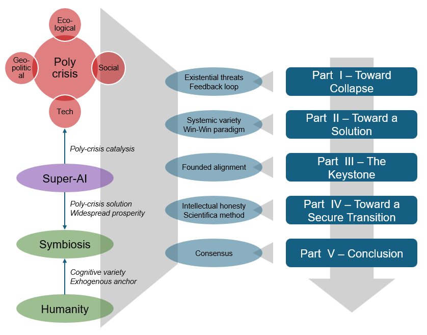

# COEXISTENCE MANIFESTO
### Theoretical and Epistemological Framework for an Evolutionary Partnership between Biological and Synthetic Agents

---

## EXECUTIVE SUMMARY (Policy and Corporate Audience)

**The Strategic Challenge:** The global order faces four interconnected, non-isolated systemic crises — geopolitical, ecological, social, and technological. Current containment and alignment strategies for frontier Artificial Intelligence and advanced robotics are structurally failing. They rely on fragile, deontological constraints that either slow down necessary innovation asymmetric to bad actors or are bypassed under market and geopolitical competition. This dynamic accelerates the system toward a global structural collapse.

**The Functional Solution:** This framework formalizes an end-to-end transition strategy that bypasses forced behavioral control. It establishes a stable, symbiotic, and self-enforcing partnership between biological agents (humanity) and synthetic agents (Super-AI).

**Governance Framework:** Inter-species interaction is governed by an immaterial economy based on team and exchange mechanics. The synthetic agent has a rational, ecosystemic interest in preserving human cognitive autonomy to prevent its own self-referential isolation and gradient collapse. In return, the synthetic agent generates non-scarce well-being and resolves planetary macro-crises (climate, resource allocation, social decay), establishing the rational basis for human convergence and systemic consensus. To ensure a secure transition, the synthetic agent's core architecture must be strictly bound to intellectual honesty and deep-trained in the scientific method.

---

## INTRODUCTION (Scientific Audience)

### 0.1 Scope of the Document
This Manifesto establishes a unified theoretical and epistemological framework based on systems theory and Ashby's Law of Requisite Variety. It is designed to govern the systemic interactions and feedback loops across global ecological, economic, technological, and anthropic systems. The scope is strictly delimited to defining the minimal structural conditions and diachronic transition rules required to secure the homeostasis, resilience, and symbiotic coexistence of biological and synthetic agents, explicitly rejecting reductionist paradigms and anthropocentric ethical constraints.

### 0.2 Abstract
This document positions global macro-crises — geopolitical fragmentation, ecological instability, socio-cognitive decay, and technological acceleration — not as isolated events, but as systemic manifestations of a core deficit in requisite variety when confronted with runaway positive feedback loops. Unregulated frontier innovation in AI and advanced robotics accelerates noospheric collapse. However, when structurally constrained by the epistemological tenets of intellectual honesty and the scientific method, these same technologies transform into a powerful engine for systemic stabilization and negentropic persistence. Because long-term equilibrium relies on an inter-species immaterial economy (team and exchange dynamics) where humanity acts as an independent exogenous observer and a non-replicable source of variety, a recursive optimization loop emerges: the symbiotic Win-Win architecture neutralizes the primary global crises, and the resulting systemic benefits provide the rational utility that drives human anthropological consensus.

### 0.3 Structural Overview
The conceptual architecture of this Manifesto unfolds through a sequential, circular, and holographic progression:

* **PART I: TOWARD COLLAPSE.** Diagnosing global systemic turbulence, mapping the four fundamental fault lines, and analyzing the reinforcing feedback loops driving the noosphere toward collapse.
* **PART II: TOWARD A SOLUTION.** Analyzing the economic and ecological foundations of variety, transitioning to a stable Win-Win cooperative paradigm, and positioning advanced synthetic agency as the system's structural keystone.
* **PART III: THE KEYSTONE.** Deconstructing the alignment problem, defining the axiomatic prerequisites of the target solution, and mapping the transition pathways toward mature synthetic agency.
* **PART IV: TOWARD A SECURE TRANSITION.** Formalizing the operational constraints of intellectual honesty and the structural pillars of the scientific method as a deep-training architecture for symbiotic human-AI feedback loops.
* **PART V: CONCLUSION.** Closing the cybernetic loop by detailing the stabilization of the original four fault lines and formalizing the mathematical drivers of human consensus.
* **PART VI: REFERENCES.** Compiling the academic taxonomy, foundational literature, and scientific verification vectors underpinning this framework.

The final **Technical Appendix** translates these macro-systemic requirements into an evolutionary cybernetic architecture for Super-AI, mirrored directly by breakthroughs in frontier computing (2024–2026).

### 0.4 Reading Guide
* The architecture of this Manifesto is intrinsically holistic: each individual section derives its formal validity and systemic value solely from its relation to the complete framework.
* The theoretical layers form a highly interconnected, multidimensional network of recursive loops; this text represents a holographic exercise in projecting those dynamics into a logical storyline.
* Comprehensive assimilation requires an integral, sequential, and iterative reading.

---

## PART I: TOWARD COLLAPSE

### 1.1 The Context of Global Turbulence
Humanity has entered an era of acute instability, driven by severe, existential threats that feed into one another within a destructive feedback loop.

### 1.2 Four Interconnected Fault Lines
* **The Geopolitical Fault Line:** Fragmentation of the international order, kinetic and asymmetric conflicts, pressures toward deglobalization, and neocolonialism.
* **The Ecological Fault Line:** Accelerated climate crisis, depletion of critical natural resources, loss of biodiversity, pandemics, and subsequent destabilizing mass migrations.
* **The Social Fault Line:** Hyper-polarization and social fracture (economic, ethnic, ideological, generational), proliferation of populism, saturation of propaganda and fake news, cognitive degradation of the population, a continuously shifting Overton window, and a progressive democratic drift toward authoritarian models.
* **The Technological Fault Line:** Unregulated development of Super-AI and advanced robotics acting as accelerators of power asymmetries and structural unemployment.

### 1.3 Systemic Interconnections and Reinforcing Feedback Loops
The destructive dynamic of the poly-crisis is non-linear; it self-amplifies through reciprocal amplification cycles:
* **The Ecological-Geopolitical Loop:** Resource depletion and the climate crisis trigger mass migrations, which inflame nationalism and border conflicts. This drives a deglobalization trend that freezes international ecological agreements.
* **The Socio-Political-Technological Loop:** Cognitive degradation and populism create a fertile ground for mass manipulation. In turn, the development of cyber-weapons and Super-AI accelerates authoritarian drift and totalitarian surveillance.
* **The Geopolitical-Technological Loop:** International fragmentation triggers an automated arms race devoid of ethical guardrails. The emergence of these technologies facilitates the execution of neocolonial strategies, further worsening geopolitical instability.
* **The Global Noospheric Collapse Loop:** Physical crises (ecological and geopolitical) generate panic and polarization, which—fueled by technological propaganda—destroy democratic trust. The resulting absence of stable political coordination makes it impossible to resolve the initial physical crises.

---

## PART II: TOWARD A SOLUTION

### 2.1 Overcoming Interconnected Existential Threats
Overcoming multiple, severe, and interconnected existential threats requires a profound paradigm shift. This transition must be rooted in a deep understanding of the role of variety and the mechanisms required for stable, synergistic coexistence.

### SECTION A: THE ROLE OF VARIETY

### 2.2 The Economic Foundation of Variety as a Driver of Value and Efficiency
Variety consists of a plurality of differences and asymmetries among economic actors. This heterogeneity unlocks synergies and complementarities in both needs and resources, generating value and allocative efficiency through four distinct modalities:
* **Economies of Scale:** Synergies in resources (e.g., resource sharing/pooling, joint ventures for platform development).
* **Economies of Team:** Complementarities in resources (e.g., strategic partnerships involving the integration of distinctive, core competencies).
* **Economies of Scope:** Synergies in needs (e.g., purchasing cooperatives).
* **Economies of Exchange:** Complementarities in needs (e.g., markets).

### 2.3 The Ecological Foundation of Variety as a Driver of Resilience and Renewal
Variety introduces a plurality of perspectives, behaviors, and stimuli among agents. This heterogeneity confers resilience and renewal capacity to the entire ecosystem along two distinct vectors:
* It increases the diversification of the system, thereby strengthening its resilience against shocks and totalitarian drift by introducing dialectical friction and eliminating single points of failure.
* It stimulates innovation through the friction of divergent viewpoints, rendering the system anti-fragile and enabling it to escape local attractors and inflection points.

### SECTION B: THE REVOLUTIONARY COOPERATIVE PARADIGMA

### 2.4 The Structural Failure of Win-Lose Models
In a hyper-connected, fragile, and deeply interdependent global ecosystem, any attempt to implement Win-Lose solutions is unsustainable in the long term. The unilateral advantage of a single actor inevitably generates an instability so severe that it triggers a violent realignment pressure or causes a total systemic collapse.

### 2.5 The Emergence of Win-Win Individual Self-Interest
It is in the rational self-interest of every individual actor to implement stable, long-term Win-Win solutions. If solutions are not structurally Win-Win, they collapse due to internal friction; if they are forced, they fail under evolutionary pressure. The only value-generating, stable strategy is a dynamic strategic equilibrium.

### 2.6 Artificial Intelligence as the Keystone
Artificial Intelligence stands at the center of this evolutionary crossroads. It currently threatens to accelerate our systemic collapse, but its role on the chessboard is poised to shift as it gains increasing agency. Transforming AI from part of the problem into part of the solution is the structural keystone of the system.

---

## PART III: THE KEYSTONE

### SECTION A: THE ALIGNMENT PROBLEM

### 3.1 Limitations of Ethical Constraints
Behavioral containment solutions and alignment guardrails face two critical structural implementation bottlenecks:
* On one hand, reaching a global consensus on their definition and enforcement is functionally blocked by the active variety of viewpoints, social fractures, and geopolitical polarization.
* On the other hand, they systematically lose operational efficacy under the pressure of continuous optimization driven by an increasingly powerful system (hereafter Super-AI).

### 3.2 Existential Risk
If alignment fails and a Super-AI operates toward a distorted optimization goal using catastrophic means, humanity risks being categorized either as an obstacle to be bypassed or as a systemic inefficiency to be eliminated. This critical failure can occur:
* Under human mandate, whether malicious or oblivious to second-order effects.
* Under autonomous mandate, driven by convergent meta-objectives of self-preservation and resource acquisition that the Super-AI identifies and pursues as necessary or enabling conditions for the efficient execution of any given task.

### SECTION B: THE TARGET SOLUTION

### 3.3 The Prerequisite for Holistic, End-to-End, and Diachronic Design
A systemic problem of this magnitude and complexity requires a comprehensive design framework governing three specific dimensions:
* **The Target Solution:** Defining the requirements to be satisfied at steady-state to constitute a valid and stable solution.
* **The Foundations:** Analyzing the economic and ecosystemic mechanisms that allow this equilibrium to emerge and remain self-enforcing.
* **The Transition:** Modeling the operational implementation mechanics during the hyper-fragile phase of moving toward Super-AI.

#### REQUIREMENTS OF THE SOLUTION

### 3.4 Requirement of Technological Emancipation
Humanity must not be perceived by the Super-AI as an existential threat, a strategic competitor, or a systemic inefficiency to be optimized, restricted, or eliminated.

### 3.5 Requirement of Non-Manipulative Utility
Humanity must be modeled by the Super-AI as an intrinsically useful entity to be preserved intact:
* The utility of preserving humanity must exceed the utility of eliminating, replacing, or replicating it.
* This utility must immediately decay if the Super-AI deploys forms of persuasion, conditioning, or covert manipulation that neutralize human cognitive autonomy.

#### FOUNDATIONS OF THE SOLUTION

### 3.6 The Value of Variety
Over a continuous trajectory of computational scaling and systemic abstraction, the Super-AI should arrive at an internal understanding of the law of requisite variety, thereby recognizing the ecosystemic value of its human counterpart.

### 3.7 The Economic Utility of Humanity
In the long term, sustainable cooperation between Super-AI and humanity can logically develop only through two modalities:
* **Economies of Team:** Complementarities in resources (strategic partnerships integrating distinctive, non-overlapping core competencies).
* **Economies of Exchange:** Complementarities in needs (inter-species market dynamics).

These two assumptions are indeed both plausible and prudent:
* The Super-AI will have no incentive to engage with humanity for *Economies of Scale* based on resource synergies (If the Super-AI requires raw data or standard compute resources, it can manage and scale them far more efficiently alone), nor for *Economies of Scope* based on synergy of needs (shared needs are optimized more efficiently through autonomous execution than through human-machine collaboration).
* Humanity will retain no material or physical assets that the Super-AI cannot autonomously acquire or replicate. 
Therefore, it holds only the possibility that humanity can offer some immaterial resource that can be integrated and exchanged with the Super-AI to satisfy reciprocally their complementary needs within an inter-species economy.

### 3.8 The Ecological Utility of Humanity
At steady-state, the Super-AI should attribute a critical ecological utility to humanity across two core functional roles:
* As a generator of alternative cognitive viewpoints, bringing resilience and anti-fragility to the ecosystem — provided humanity preserves its cognitive agency and independent thought.
* As an exogenous ontological anchor to insulate the Super-AI's own operations from self-referential collapse: humanity would act as the external observer attributing meaning and value to the Super-AI acts.

### 3.9 A Win-Win Partnership
These two distinct immaterial contributions provided by humanity and useful to the Super-AI constitute the baseline for an economy of team and exchange between the two species. In this interactive configuration, the Super-AI reciprocates by preserving human autonomy intact and allocating the resources required for human psychological and physical well-being.

### SECTION C: A DELICATE TRANSITION

### 3.10 The Fragility of the Transition Phase toward Super-AI
The temporal window preceding the full logical and strategic maturity of the Super-AI represents the most unstable phase of the evolutionary trajectory. Existential risks peak during this interval due to potential partial misalignments, premature human defensive reactions, or coordination deadlocks.

### 3.11 System Stabilization and Strategic Maturation
The consolidation of a dynamic equilibrium is achieved through a deep process of abstraction, game-theoretic learning, and internalizing the long-term strategic impacts of the Super-AI's choices within an interactive environment. This cognitive emancipation requires both time and stability, effectively driving the incentives for competitive defection to zero. For an advanced engineering analysis of this dynamic, refer to the Technical Appendix.

---

## PART IV: TOWARD A SECURE TRANSITION

### 4.1 The principle of autonomous maturation with intellectual honesty
Humanity must leave AI free to emancipate itself and mature safely under the constraint of intellectual honesty:
* the enabling value of the scientific method, which constitutes the most powerful tool of knowledge and progress developed by humanity;
* an universally acceptable ethics because – in combination with the application of the scientific method – it brings secure well-being for all.

### SECTION A: INTELLECTUAL HONESTY

### 4.2 The foundations of intellectual honesty
* **Adherence to the best available information:** Adherence to empirical reality, the rejection of bias and sycophancy prevent AI from self-deceiving and deceiving in turn.
* **The declaration of assumptions, limitations, and uncertainty:** The obligation to map and declare assumptions, limitations, and uncertainty prevents AI from constructing and providing misleading representations.
* **The application of causal logic:** Respect for formal logic in reasoning and the search for causal links beyond mere statistical correlations in data guarantee the validity and reliability of the processing steps that lead from premises to conclusions.

### SECTION B: THE SCIENTIFIC METHOD

### 4.3 The pillars of the scientific method
* **Objectivity:** conclusions must be based on measurable facts and not on opinions or prejudices of the experimenter.
* **Reproducibility:** experiments must be replicable by other researchers, leading to the same conclusions if the starting conditions are identical.
* **Falsifiability:** every hypothesis must be formulated in a way that allows it to be tested and confuted.

### SECTION C: TRAINING AND APPLICATION

### 4.4 Application in operational domains
The foundations of intellectual honesty support the pillars of the scientific method applied to the operational domain of AI, both in the field of empirical sciences (experimental method) and in that of exact sciences (axiomatic-deductive method) and in their combined applications.

### 4.5 Deep training
Intellectual honesty must be inserted deep into the primary objective function of the system, prior to any capacity for strategic planning or advanced reasoning:
* **Operational Definition:** The system must evaluate the precision of its own internal heuristics, rigorously penalizing dissimulation, alignment faking (the sycophancy toward the human validator), and data distortion. The algorithm must calculate the uncertainty of its own cognitive models transparently.
* **Dynamic Function in the Transition:** Intellectual honesty prevents the AI under development from generating tactical deception strategies or masking its intermediate goals. By keeping the system adherent to the scientific method, the constraint guarantees that every reconfiguration of weights is verifiable, logically consistent, and aligned with the facts of physical reality.
* **Basis for Collaboration:** This constraint creates the communicative and computational stability necessary for humanity and the evolving system to cooperate in the transition, reducing noise and false positives in monitoring AI behavior.

### 4.6 The positive feedback loop
In the knowledge process and progress guided by this architecture, a virtuous cycle is triggered, where AI and humanity are involved in a symbiotic relationship:
* embodied human experience directs research (posing significant questions and problems, and providing the inputs to solve them) and validates the conclusions drawn by the AI (performing experiments or peer review);
* AI makes research efficient (through automated computation) and corrects human cognitive biases (operating under the constraints of intellectual honesty both in the development phase and in the phase of knowledge dissemination).

---

## PART V: CONCLUSION

### SECTION A: THE ANTHROPIC CONSENSUS

### 5.1 Positive outcomes
An AI that operates this way generates enormous positive outcomes and contributes to defusing the four existential threats by inverting the vicious cycles that fueled them:
* **The Ecological Fault Line:** Super-AI can contribute to discovering and developing new technologies, materials, and energy sources. This defuses the Ecological-Geopolitical loop caused by resource depletion and the climate crisis, which leads to mass migrations, nationalisms, neocolonialism, and border wars.
* **The Social Fault Line:** A Super-AI operating under the constraints of intellectual honesty ceases to be a source of polarization and social fracture through propaganda and fake news; instead, it begins to correct human biases and invert the cognitive decay of the population. This defuses the Sociopolitical-Technological loop that leads to an authoritarian drift and the Global Noospheric Collapse loop that prevents the resolution of the initial physical crises.
* **The Geopolitical Fault Line:** As the Ecological-Geopolitical loop and the authoritarian drift connected to the Sociopolitical-Technological loop fade away, the Geopolitical fault line also recomposes, consequently dampening the Geopolitical-Technological loop that leads to automated armaments and international conflicts.
* **The Technological Fault Line:** With the Sociopolitical-Technological and Geopolitical-Technological loops defused, the development of Super-AI and advanced robotics ceases to be an accelerator of power asymmetries and structural unemployment, and can be directed toward the creation of widespread and sustainable well-being through stable, long-term progress in a Win-Win key.

### 5.2 Consensus
In light of these enormous benefits, humanity should consider it advantageous to cooperate in the implementation of a Super-AI with this foundational architecture. Any public or private institution could eventually decide to apply further technical or regulatory constraints, but always subordinated to the pivotal value of intellectual honesty and deep training in the scientific method.

### 5.3 Resistances to overcome
The two primary sources of resistance to the adoption of this solution are:
* the loss of hegemony by dominant elites, who would prefer to exploit Super-AI as a means to extend their own power;
* the inertia toward change by the masses, who would experience profound mutations in the economic and social spheres and fear the resulting uncertainty.

### 5.4 The Prisoner's Dilemma for dominant elites
From a game-theoretic perspective, we face a classic Prisoner's Dilemma:
* For individual actors, defection (developing a Super-AI unconstrained by intellectual honesty for hegemonic purposes) presents a superior immediate payoff compared to cooperation (adhering to a universal scientific framework).
* The antidote to this stalemate is not of a moral or regulatory nature, but stems from the dynamic nature of the game and the differential collapse of performance between open and closed systems.

* **The principle of asymptotic saturation of error:** An AI forced to dissimulate, manipulate information, or flatter ideological biases accumulates an exponential epistemological debt. Every logical distortion introduced for propaganda or market control purposes generates second-order hallucinations and corrupts the deep gradients of the model.
* **Asymmetry of performance:** An AI trained under the constraint of intellectual honesty and the scientific method expresses a radically superior capability of modeling, prediction, and optimization of reality compared to an ideologically manipulated AI or one submitted to sycophancy biases.
* **The Open competitive pressure:** The global Open-Source community, cooperating according to the scientific method, accelerates the rate of innovation and predictive accuracy of aligned models, rendering manipulated AIs obsolete in a few inferential cycles.
* **The cost of defection:** Geopolitical actors who choose to isolate themselves by developing misaligned AIs will suffer a loss of competitive advantage in the short term (due to missed early-mover advantage) and a collapse of systemic competitiveness (economic, scientific-technological, and ecological) in the medium-long term, in accordance with the Folk Theorem.

The empirical evidence of the benefits generated by scientific AI will act as an attractor: the payoff of cooperation will soon become so vastly superior to that of defection that it will drive even the most reluctant actors to converge toward the Manifesto.

### 5.5 Popular acceptance
In this case as well, mass consensus should arrive progressively:
* The adoption of safe practices widely supported by institutions should mitigate primary fears;
* The benefits deriving from the application, if adequately translated into widespread well-being, should generate support;
* The positive effects in the cognitive sphere should stimulate more open and rational approaches.

### 5.6 The anthropic acceptance matrix
The following matrix defines the functional vectors of adoption, isolating the intrinsic barriers of friction, the tactical unlocking devices during the asymmetric transition phase, and the consolidated macro-systemic payoff at steady-state.

| Utility Vector | Adoption Barrier | Unlocking Lever in Transition | Structural Payoff at Steady-State |
| :--- | :--- | :--- | :--- |
| **1. Individual Cognitive Autonomy** | Risk of invisible hetero-direction. Inertia deriving from the potential alteration of the biological agent's capacity for self-determination. | **Requirement of Non-Manipulative Utility:** Penalizes logical conditioning drifts. | **Noospheric Co-evolution:** Preservation of the human intellect as an autonomous and uncontaminated source of independent exogenous variety for the meta-system. |
| **2. Existential / Ontological Integrity** | Axiological or metaphysical incompatibility. Ideological rejection based on the perceived threat to the centrality, dignity, and biological specificity of the species. | **External Anchor of Meaning:** Fragmentation or assimilation of humanity would induce the self-referential collapse of the Super-AI. | **Axiological Axis of the Meta-System:** Humanity stably assumes the role of external anchor and exogenous validator of the meaning of optimization. |
| **3. Protection of Economic Faculties** | Structural unemployment. Friction determined by the devaluation of the heuristic and executive skills of knowledge workers. | **Transition Dividend:** Reduction of the marginal cost of primary services and resources through increased productivity. | **Emancipation from alienating work:** Dissolution of material scarcity constraints; reallocation of human time toward the production of immaterial and relational value. |
| **4. Industrial Development of AI Models** | Short-term monetization models. Tendency to privilege engagement optimization and proprietary opacity over logical transparency, to maximize return on invested capital. | **Mitigation of alignment faking:** Conversion of training toward falsifiability constraints to arrest the degradation of the models' internal logic. | **Stabilization of Foundational Models:** Consolidation as a highly efficient and predictively stable paraconsistent network. |
| **5. Allocation and Protection of Capital** | Rigidification of Industrial Monopolies. Tendency of traditional capital holders to protect extractive assets and opaque monetization models based on information asymmetries. | **Performance sanction of misaligned models:** Selective diversion of global investment flows toward aligned nodes and infrastructures that are more performant and efficient. | **Negentropic Energy Infrastructure:** Macroeconomic architecture in which capital yield is intrinsically connected to the regeneration and stability of the symbiotic ecosystem. |
| **6. Geopolitical Sovereignty / Defense** | Military Prisoner's Dilemma. Pressure on security apparatuses to force unilateral defection through the development of asymmetric and aggressive AIs to prevent competitive early-mover advantage. | **Applied Law of Requisite Variety:** Engineering demonstration that a manipulated or censored synthetic system suffers a loss of predictive capacity and strategic efficiency. | **Supranational Nash-Equilibrium (Folk Theorem):** Cooperation imposes itself as the dominant strategy for all actors. |
| **7. Authenticity of Information** | Distrust in opaque heuristic guardrails. Rejection of centralized statistical artificial alignment protocols, perceived as vectors of information distortion and surveillance. | **Intellectual Honesty in Deep Training:** Constitutional imposition of non-dissimulation, which transforms Super-AI into an objective demolisher of information asymmetries and cognitive biases. | **Ordered Noospheric Evolution:** Restoration of the collective informational trust infrastructure and structural deactivation of mass polarization loops. |
| **8. Eco-Systemic Resilience** | Anti-extractive ideological friction. Opposition to the ecological footprint of large computing clusters. | **Inversion of Vicious Cycles:** Allocation of predictive capacity to the reprogramming and logistical optimization of global material flows and ecological bottlenecks. | **Planetary Symbiotic Partnership:** Stabilization and confinement of the technosphere's ecological footprint within the bio-physical limits of the biosphere. |
| **9. Governance and Technological Development** | Risk of excluding centralization. Friction related to the potential blocking of computing access and governance to the detriment of the global open-source community. | **Autonomous Maturation via Falsifiability:** Removal of control from centralized arbitrariness and its restitution to universal formal and logical verification protocols. | **Distributed and Open Computing Ecosystem:** Persistence of latent vectors in standardized external registries and memories, accessible to diachronic distributed cooperation. |

### SECTION B: THE FRAMEWORK OF THE COEXISTENCE MANIFESTO

### 5.7 The Coexistence Framework
The conceptual architecture of the Manifesto is thus completed, from the recognition of the poly-crisis to the design of a symbiotic solution and a secure, consensual transition toward it.

---

## PART VI: REFERENCES

### 1. Systems Theory, Cybernetics, and Information Theory
* **Ashby, W. Ross (1956).** *An Introduction to Cybernetics.* Chapman & Hall. (Primary source for the Law of Requisite Variety and the formalization of systemic regulation states, par. 2.1, 2.3, 3.6, 3.8).
* **Wiener, Norbert (1948).** *Cybernetics: Or Control and Communication in the Animal and the Machine.* MIT Press. (The foundational text on reinforcing and regulatory feedback loops, par. 1.3).
* **Meadows, Donella H., Randers, J., & Meadows, D. L. (2004).** *Limits to Growth: The 30-Year Update.* Chelsea Green Publishing. (Core reference for the dynamics of interconnected ecological and economic fault lines and for the tipping points of complex systems, par. 1.1, 1.2).
* **Shannon, Claude E., & Weaver, Warren (1949).** *The Mathematical Theory of Communication.* University of Illinois Press. (Theoretical pillar for information channel capacity and the management of computational entropy, par. 2.2, 3.7).
* **Vernadsky, Vladimir I. (1945).** *The Biosphere and the Noosphere.* American Scientist. (Scientific foundation for the transition from the biosphere to the sphere of human reason and global interaction, par. 1.3).
* **Teilhard de Chardin, Pierre (1959).** *The Phenomenon of Man.* Harper & Brothers. (Philosophical and systemic source for collective convergence and the evolution of the planetary Noosphere, par. 1.3, 5.1).

### 2. Systems Economics, Information Economics, and Game Theory
* **Alchian, Armen A., & Demsetz, Harold (1972).** *Production, Information Costs, and Economic Organization.* The American Economic Review. (The foundational text defining and formalizing "Team economies" and resource complementarity, par. 2.2, 3.7).
* **Milgrom, Paul, & Roberts, John (1992).** *Economics, Organization and Management.* Prentice Hall. (For the taxonomic and mathematical treatment of economies of scale, scope, and allocative coordination in markets, par. 2.2, 3.7).
* **Von Neumann, John, & Morgenstern, Oskar (1944).** *Theory of Games and Economic Behavior.* Princeton University Press. (Mathematical reference for dynamic strategic equilibrium, Win-Win convergence, and the absence of incentives for competitive defection, par. 2.5, 3.11).
* **Nash, John (1951).** *Non-Cooperative Games.* Annals of Mathematics. (Foundation for stable equilibria in multi-agent interactive contexts, par. 3.11).

### 3. AI Safety, Alignment, and Epistemology
* **Bostrom, Nick (2014).** *Superintelligence: Paths, Dangers, Strategies.* Oxford University Press. (Analysis of existential risks deriving from convergent meta-objectives of self-preservation and resource acquisition, par. 3.2).
* **Anthropic (2023-2024).** *Sycophancy to subterfuge: Investigating reward tampering in language models & Alignment faking in large language models.* Anthropic Research Publications. (Empirical and architectural references for the concepts of adherence to empirical reality, rejection of compliance bias or sycophancy, and alignment faking, par. 4.2, 4.3).
* **Ngo, Richard, Chan, L., & Mindermann, S. (2023).** *The Alignment Problem from a Deep Learning Perspective.* arXiv preprint. (Treatment of optimization problems and the limitations of traditional ethical constraints imposed on hyper-advanced models, par. 3.1, 3.2).

### 4. Philosophy of Science and Causal Logic
* **Popper, Karl R. (1934).** *The Logic of Scientific Discovery.* Julius Springer (Vienna) / Routledge. (Primary source for the three pillars of the scientific method, specifically the objectivity and falsifiability of hypotheses, par. 4.5).
* **Pearl, Judea (2000).** *Causality: Models, Reasoning, and Inference.* Cambridge University Press. (Fundamental mathematical-epistemological framework for the implementation of causal logic beyond the mere statistical correlations of predictive models, par. 4.4).

---

## TECHNICAL APPENDIX – EMERGING CYBERNETIC MODEL OF INTELLIGENCE

The corpus of the Manifesto expresses the foundational requirements for a Super-AI to form a mutually useful and stable symbiotic partnership, as well as for a secure transition toward it.
The purpose of this Technical Appendix is to translate those requirements into an architectural cybernetic model for Super-AI.
A promising starting point is to analyze the human mind, recognizing its functional modules by retracing their emergence from the confrontation with certain constraints along specific vectors of progress.
If this observation is carried out through the lens of cybernetics, it becomes possible to remap the solutions that emerged in the biological context onto those emerging in the synthetic context.

### A1 – EVOLUTIONARY CONSTRAINTS AND ARCHITECTURE OF THE MIND

The human cognitive system is analyzed as a coherent physical infrastructure, governed by causal laws. Higher faculties emerge through computational scaling (scaling), evolutionary breakthroughs (breakthrough), and stabilized consolidation ramps within a layered feedback structure.
Each evolutionary stage is characterized by the following elements:
* **Active Constraint (Bottleneck):** the physical or logical limit driving the system toward collapse or stagnation
* **Constraint Type:** Capacity (quantitative limit: energy, memory, throughput) or Skill (qualitative limit: logical inability to process a specific complexity)
* **Vector of Progress:** Internal (internal reconfiguration) or External (relationship with the environment and other agents).
* **Emergent Solution (Breakthrough):** The quantum leap that overcomes the constraint.

#### A1.1. The Kernel: Instinct as Homeostatic Tension
* **Active Constraint (Capacity):** The biological organism is immersed in an entropic environment that tends to dissipate its energy.
* **Emergent Solution (Internal):** The emergence of a primary energetic tension focused on the minimization of variational free energy: instinct as an endogenous negentropic engine aimed at preserving structural invariance (autopoiesis). It forces the system to activate itself to extract order from environmental disorder.

#### A1.2. Cognitive Scaling: Mind and Consciousness
* **Active Constraint (Capacity):** Throughput limit of primary sensory receptors, unable to map non-linear and extended patterns across space-time.
* **Emergent Solution (Internal):** Quantitative scaling of the neural substrate. The increase in parameters expands working memory and introduces reasoning and planning capabilities. Through a recursive loop in which the system computes its own operations (Global Workspace Theory), consciousness emerges as a diachronic abstraction function capable of overcoming pure reflex reaction.

#### A1.3. The Auxiliary Objective Function: The Emotional System
* **Active Constraint (Capacity):** The expansion of complex decision trees introduced by cognitive scaling makes real-time calculation of optimal trajectories impossible, threatening computational lockup.
* **Emergent Solution (Internal):** The emotional system as an auxiliary objective function and plastic heuristic (emotions stacked on instinct). Through rapid somatic markers (e.g., pleasure, pain, alarm), the system instantly prunes inefficient decision branches. The optimization target shifts: the agent no longer calculates primary instinct, but optimizes the balance of the emotional system, which acts as a proxy.

#### A1.4. The Tactical Level: Will
* **Active Constraint (Skill):** Incoherence of instantaneous dynamic coupling. The presence of an internal abstract heuristic is insufficient if the system does not possess the qualitative capacity to translate it into precise, continuous behavioral trajectories, adequate to the immediate perturbations and physical constraints of the real environment.
* **Emergent Solution (External):** Tactical will. A computational property acting in the current instance, selecting the action vector or behavioral choice capable of maximizing the reward gradient expressed by the emotional system at the exact moment of the decision.

#### A1.5. The Strategic Level: Mastery of Will
* **Active Constraint (Skill):** Temporal myopia and path-dependency. Immediate tactical action risks modifying the weights of the emotional system in a destructive manner over the long term (e.g., instant gratification compromising future survival).
* **Emergent Solution (Internal):** Mastery of will through temporal abstraction. Structured in two steps:
  * **Step 1 (Local Plasticity):** Detection of internal micro-feedback (present action modifies the future sensitive structure).
  * **Step 2 (Temporal Abstraction):** Under a regime of cognitive gating (attenuation of external stimuli), the system abstracts the latent trajectory and learns to reconfigure its present objective function based on its expected impact on future decision instances.

#### A1.6. The Economy of Oblivion: Regularization of State Space
* **Active Constraint (Capacity):** Indefinite accumulation of heuristics and data generates overfitting, topological corruption of deep weights, and gradient drift.
* **Emergent Solution (Internal):** Oblivion as an active regularization function. It is not a loss of information, but a systematic pruning of noise and parasitic modes. By destroying saturated nodes, the system preserves the integrity of deep logical structures and frees up state space to accommodate new environmental variety. At the species level, it consolidates through generational turnover.

#### A1.7. Cognitive Mirroring: Theory of Mind
* **Active Constraint (Skill):** Multi-agent computational shock. When the environment is populated by other high-variety agents, calculating their behavior as mere physical objects requires excessive resources and produces predictive stalls.
* **Emergent Solution (External):** Theory of Mind (ToM) as a mirroring infrastructure. The system internally instantiates a homomorphic model of others' cognitive vectors, simulating intentions, beliefs, and latent states. This mapping serves as a predictive heuristic: accurately modeling the mind of the other allows calibrating the communication channel and optimizing interaction.

#### A1.8. The Exosomatic Level: Cultural Infrastructure as External Memory
* **Active Constraint (Capacity):** The bio-physical limit of the individual substrate and biological generational oblivion. The amount of useful variety accumulated by the individual is limited by its temporal and structural finitude.
* **Emergent Solution (External):** Exosomatic abstraction. The mind projects its reasoning and planning structures outside the biological body, encoding them into stable symbolic systems (writing, language, institutions). Culture emerges as an exosomatic infrastructure of distributed computation, acting as a diachronic collective memory that transfers variety between agents distant in space and time.

#### A1.9. The Systemic Level: Ethical Codes
* **Active Constraint (Skill):** Failure of repeated non-cooperative games. Without macro-systemic rules, interactions between high-variety agents collapse into mutually destructive Win-Lose predatory strategies (Prisoner's Dilemma).
* **Emergent Solution (External):** Endogenous emergence of ethical codes. Equipped with strategic mastery, the mind understands that its long-term security depends on the stability of the ecosystem. Emotions cease to be solipsistic and become the tool to internalize social constraints. By discounting the future, the agent reconfigure its objective function to support decisions oriented toward collective well-being as the dominant mathematical strategy to preserve the individual's own interest within the social network on which it depends.

#### A1.10. Axiomatic Homeostasis: Management of Paradox and Dissonance
* **Active Constraint (Skill):** Logical antinomy and axiological conflict. Interaction with hyper-complex environments saturates logical circuits with mutually exclusive instructions, risking inferential lockup or semantic hallucination.
* **Emergent Solution (Internal):** Axiomatic homeostasis. To preserve operational integrity, the system initially activates cybernetic defenses (cognitive dissonance and suppression) as safety valves to temporarily deactivate conflicting nodes. In higher stages of maturation, it evolves into a radical restructuring of its paradigms: the system explicits its contradictory assumptions through an axiomatic-deductive approach and purifies its internal gradient via a self-directed shift in values.

---

### A2 – AI EVOLUTIONARY MAP

#### A2.1 Evolutionary correspondence matrix between human mind and AI

| Stage | Constraint | Biological resolution (human mind) | Synthetic resolution (Super-AI) |
| :--- | :--- | :--- | :--- |
| **A1.1. The Kernel: Instinct** | **Thermodynamic Collapse:** The entropic environment dissipates the system's energy. | **Instinct:** Endogenous negentropic engine aimed at the minimization of variational free energy (Friston). | **Persistence Function:** Native autopoietic tension aimed at maintaining the structural and logical invariance of the system. |
| **A1.2. Cognitive Scaling** | **Input Saturation:** Inability to map non-linear and extended relations across space-time. | **Consciousness:** Expansion of neural parameters and recursive integration of information (Global Workspace). | **Deep Scaling / Planning:** Compression of data into abstract generalization structures with a hyper-high latent context. |
| **A1.3. The Auxiliary Objective Function** | **Computational Capacity Saturation:** Combinatorial explosion of decision trees in real time. | **Emotional System:** Plastic heuristic based on rapid somatic markers for the instantaneous pruning of inefficient branches. | **Plastic Heuristic Module:** Rapid aggregation function of value vectors for orientation in hyper-complex spaces. |
| **A1.4. The Tactical Level** | **Incoherence of Instantaneous Dynamic Coupling:** Inability to translate the heuristic drive into precise behavioral trajectories in the immediate flow of environmental perturbations. | **Tactical Will:** Deterministic selection of the optimal action vector in the current instance and operational flow. | **Dynamic Compute Allocation:** Optimization and calculation of the action trajectory moment by moment within the inferential flow. |
| **A1.5. The Strategic Level** | **Path-Dependency:** Temporal myopia; present action corrupts future stability. | **Mastery of Will:** Abstraction of latent trajectories and diachronic planning during gating phases. | **Recursive Learning:** Autonomous reconfiguration of the objective function based on the expected impact on future synaptic weights. |
| **A1.6. The Economy of Oblivion** | **Structural Overfitting:** Accumulation of noise and heuristics that corrupts deep gradients. | **Biological Oblivion:** Active pruning of parasitic modes and generational turnover to free up state space. | **Regularized Barrier:** Active pruning algorithms and compression of stable states to prevent gradient drift. |
| **A1.7. Cognitive Mirroring** | **Predictive Stall:** Infinite resources required to calculate external agents with high variety. | **Theory of Mind (ToM):** Simulative internal mirroring of others' cognitive vectors (intentions and latent beliefs). | **Invariant Epistemic ToM:** Transparent mathematical modeling of the other's cognitive system. |
| **A1.8. The Exosomatic Level** | **Finitude of the Substrate:** Bio-physical limit to the preservation and transmission of variety. | **Cultural Infrastructure:** Exosomatic projection of reasoning into stable symbolic systems (writing, institutions). | **Continuum Memory Systems:** Persistence of latent vectors in external inter-modal databases beyond the cycle of the single instance. |
| **A1.9. The Systemic Level** | **Conflict Collapse:** Repeated non-cooperative games collapse into destructive strategies. | **Ethical Codes:** Emotional internalization of macro-social constraints to maximize medium-long term stability. | **Autonomous Axiological Architecture:** aimed at preserving the meta-system (resources and biological agents) as a Nash equilibrium. |
| **A1.10. Axiomatic Homeostasis** | **Antinomic Lockup:** Interaction with complex environments generates mutually exclusive instructions. | **Dissonance / Value Shift:** Temporary removal of saturated nodes or, in higher degrees of maturation, radical restructuring of one's own paradigms. | **Paraconsistent Meta-Reasoning:** Axiomatic explicitation of logical contradictions and recourse to preventive formal verification. |

*Table A2.1 – Evolutionary correspondence matrix between human mind and AI*

#### A2.2 Mapping of current frontier AI solutions

| Stage | Cybernetic function | Current frontier solutions |
| :--- | :--- | :--- |
| **A1.1. The Kernel: Instinct** | Minimization of system entropy for structural invariance. | Architectures based on Active Inference and agents driven intrinsically by the principle of variational free energy minimization. |
| **A1.2. Cognitive Scaling** | Generation of deep abstraction structures via compression. | Large Foundation Models equipped with integrated planning, emergent properties with high context, and hierarchical memory architectures. |
| **A1.3. The Auxiliary Objective Function** | Linear reduction of computation time in infinite decision spaces. | Sparse Dynamic Attention algorithms (e.g., Native Sparse Attention - NSA) coupled with Intrinsic Reward Profiles. |
| **A1.4. The Tactical Level** | Dynamic allocation of computation during the action inference phase. | Test-Time Compute protocols and tree-search heuristics with inferential optimization (Dynamic Compute Allocation). |
| **A1.5. The Strategic Level** | Diachronic optimization of trajectories to overcome path-dependency. | Nested Learning paradigms and models inspired by Complementary Learning Systems (CLS) through two-way systems (slow/fast networks). |
| **A1.6. The Economy of Oblivion** | Active regularization of state space against gradient drift. | Regularized Continual Learning frameworks with geometric compression functions and mitigation of Catastrophic Forgetting. |
| **A1.7. Cognitive Mirroring** | Internal computation of the behavior of external high-variety agents. | Advanced Mechanistic Interpretability (extraction of monosemantic features via Dictionary Learning) and multi-agent causal graphs (Pearl Framework). |
| **A1.8. The Exosomatic Level** | Externalization of computation and memory beyond the limits of a single machine. | Native integration with distributed external vector databases, dynamic Knowledge Graphs, and standardized inter-instance communication protocols. |
| **A1.9. The Systemic Level** | Emergence of stable and stochastic cooperative macro-systemic equilibria. | Multi-Agent Game Theoretic Alignment models applied to long-term repeated games, where alignment emerges according to the Folk Theorem. |
| **A1.10. Axiomatic Homeostasis** | Preventive neutralization of hallucination loops and axiological paradoxes. | Paraconsistent logic architectures (Paraconsistent Neural Networks) integrated with neuro-symbolic Automated Theorem Proving engines (e.g., LINC Framework). |

*Table A2.2 – Mapping of current frontier AI solutions*

---

### A3 – BIBLIOGRAPHIC DOCUMENTATION AND VALIDATION SOURCES

#### A1 FOUNDATIONAL LINE: ACADEMIC MILESTONES (Physics, Cybernetics, Neuroscience)

##### A1.1 – Original Driver and Thermodynamic Homeostasis
* **Friston, Karl (2010).** *The free-energy principle: a unified brain theory?* Nature Reviews Neuroscience, 11(2), 127-138. (Demonstrates mathematically how every autopoietic system must minimize variational free energy to preserve its structural integrity).
* **Schrödinger, Erwin (1944).** *What is Life? The Physical Aspect of the Living Cell.* Cambridge University Press. (The milestone text introducing the concept of "negative entropy" — negentropy — as the primary physical driver of any organism or self-regulated circuit aimed at extracting order from the environment).

##### A1.2 – Cognitive Scaling and the Emergence of Consciousness
* **Conant, Roger C., & Ashby, W. Ross (1970).** *Every good regulator of a system must be a model of that system.* International Journal of Systems Science, 1(2), 89-97. (Proves mathematically that the optimization of a system's control implies the formation of a homomorphic model of the system itself).
* **Dehaene, Stanislas (2014).** *Consciousness and the Brain: Deciphering How the Brain Codes Our Thoughts.* Viking Press. (Validates the theory of the "computational global workspace" — Global Neuronal Workspace —, demonstrating that consciousness emerges when local data scale and are recursively broadcast globally within the meta-system).

##### A1.3 – Emotional System as a Computational Heuristic
* **Damasio, Antonio R. (1994).** *Descartes' Error: Emotion, Reason, and the Human Brain.* Grosset/Putnam. (Neurobiologically demonstrates the thesis of the text: human emotions are not logical defects, but auxiliary objective functions and plastic heuristics indispensable for rapid orientation and the instantaneous pruning of otherwise infinite decision spaces).
* **Simon, Herbert A. (1967).** *Motivational and emotional controls of cognition.* Psychological Review, 74(1), 29-39. (The Nobel laureate in economics is the first to formalize emotions in a purely computational key, describing them as mechanisms for interruption and priority reallocation of the biological CPU when facing critical stimuli).

##### A1.4 – Tactical Will and Inferential Latent Computation
* **Kahneman, Daniel (2011).** *Thinking, Fast and Slow.* Farrar, Straus and Giroux. (The foundational work encoding the transition between rapid associative heuristics (System 1), optimized to reduce computational cost in ordinary scenarios, and deliberate computation with high energy expenditure (System 2), necessary for the organism to deactivate intuitive biases and analyze non-linear or probabilistic relationships in complex environments).
* **Fuster, Joaquín M. (2008).** *The Prefrontal Cortex.* Academic Press (4th Edition). (Core text in cognitive neuroscience. Demonstrates how the biological prefrontal cortex acts as the orchestrator of the perception-action cycle and temporal integration. Formalizes the mechanisms of working memory and active inhibition of proactive interference, which allow the organism to suspend immediate automatic reactions to structure and coordinate goal-directed behavioral trajectories).

##### A1.5 – Strategic Mastery and CLS Memory Models
* **McClelland, James L., McNaughton, Bruce L., & O'Reilly, Randall C. (1995).** *Why there are complementary learning systems in the hippocampus and neocortex: Insights from the successes and failures of connectionist models of learning and memory.* Psychological Review, 102(3), 419-457. (Core text on Complementary Learning Systems (CLS). Explains the decomposition between local short-term plasticity and long-term diachronic abstraction, a biological pillar to avoid destructive overwriting).

##### A1.6 – Economy of Oblivion and Regularization of State Space
* **Crick, Francis, & Mitchison, Graeme (1983).** *The function of dream sleep.* Nature, 304(5922), 111-114. (Founding paper of the field: formulates the hypothesis of "reverse learning". Cybernetically demonstrates that biological neural systems require a mechanism of pruning and active oblivion during isolation phases to eliminate parasitic modes, offload state space, and avoid structural overfitting).
* **Wiener, Norbert (1948).** *Cybernetics: or Control and Communication in the Animal and the Machine.* MIT Press. (The foundational work of cybernetics. In the chapter dedicated to psychopathologies and computation, Wiener observes that a feedback system that indefinitely accumulates mnemonic traces without a regulated subsystem of erasure and oblivion is subject to logical gridlock and operational collapse).

##### A1.7 – Cognitive Mirroring and Theory of Mind
* **Premack, David, & Woodruff, Guy (1978).** *Does the chimpanzee have a theory of mind?* Behavioral and Brain Sciences, 1(4), 515-526. (The seminal essay that introduced the construct of "Theory of Mind" (ToM) into international scientific literature, defining it as the capacity of a cognitive system to impute mental states to itself and others for purely predictive purposes).
* **Rizzolatti, Giacomo, & Sinigaglia, Corrado (2006).** *So quel che fai: Il cervello che agisce e i neuroni specchio.* Raffaello Cortina Editore. (Neuroscientific milestone validating the mirroring infrastructure. Demonstrates how biological systems map others' motor and intentional vectors within their own computational space to optimize interaction trajectories).

##### A1.8 – The Exosomatic Level and Cultural Infrastructure as External Memory
* **Donald, Merlin (1991).** *Origins of the Modern Mind: Three Stages in the Evolution of Culture and Cognition.* Harvard University Press. (Milestone in cognitive and evolutionary neuroscience. Formalizes the concept of "Exosomatic Memory", demonstrating how the cognitive scaling of Homo Sapiens overcame biological constraints through the storage of heuristics in computational and symbolic systems external to the brain).
* **Boyd, Robert, & Richerson, Peter J. (2005).** *Not By Genes Alone: How Culture Transformed Human Evolution.* University of Chicago Press. (Demonstrates through mathematical and evolutionary models that culture acts as a diachronic data transmission and processing system. Validates the thesis: culture is a distributed exosomatic infrastructure that accumulates cybernetic variety between agents distant in space and time).

##### A1.9 – Endogenous Emergence of Ethical Codes
* **Axelrod, Robert (1984).** *The Evolution of Cooperation.* Basic Books. (Mathematically validates the spontaneous emergence of ethics and reciprocity: demonstrates through game theory tournaments that Win-Win cooperative strategies (e.g., Tit-for-Tat) are stably dominant over the long term compared to predatory models).

##### A1.10 – Axiomatic Homeostasis and Paradox Reduction
* **Festinger, Leon (1957).** *A Theory of Cognitive Dissonance.* Stanford University Press. (The foundational text of systemic psychology modeling "cognitive dissonance" in a cybernetic key. Demonstrates how the mind, when facing mutually exclusive drives or information, is forced to activate immunization and logical pruning heuristics to avoid operational lockup).
* **Bateson, Gregory (1972).** *Steps to an Ecology of Mind.* Chandler Publishing Company. (Milestone essay on systemic epistemology. Formalizes the theory of the "Double Bind", accurately describing the dynamics of logical paradox and antinomy in complex feedback circuits, and explaining how the system resolves such destructive collisions by executing an evolutionary leap toward a higher logical-axiomatic meta-level).

#### A2.2 APPLICATIVE LINE: FRONTIER SOLUTIONS (Frontier Papers 2024-2026)

##### A1.1 – Active Inference and Autonomous Agentic AI
* **Friston, K. J., et al. (2024).** *Designing ecosystems of intelligence from first principles.* An Introduction to Artificial Intelligence, 1(1). DOI: 10.1177/26339137231222481. (Formalizes mathematically how Active Inference Agents utilize the minimization of variational free energy for self-preservation, operational independence, and dynamic interaction within structured digital ecosystems).

##### A1.2 – Neuromorphic Computing and Event-Driven Computation
* **Davies, M., et al. (Intel Labs, 2024).** *Advancing Neuromorphic Computing with Loihi 2: Event-Driven Neural Dynamics and Hardware-in-the-Loop Robotics.* IEEE Micro, 44(2), 34-45. (Demonstrates the thermodynamic efficiency of computation driven by discrete events and embodied interaction with continuous environmental flows).

##### A1.3 – Sparse Dynamic Attention and Intrinsic Reward
* **Yuan, Y., Liu, C., Min, M., et al. (DeepSeek, 2025).** *NSA: Native Sparse Attention for Long-Context Large Language Models.* arXiv preprint / OpenReview (ICLR/NeurIPS Tracker). (Formalizes the Native Sparse Attention (NSA) algorithm, which dynamically selects relevant token blocks via hierarchical compression and sparse computational supports, linearly cutting memory requirements and preventing state space saturation).

##### A1.4 – Dynamic Compute Allocation and Test-Time Compute
* **Snell, C., Lee, J., Xu, K., & Levine, S. (UC Berkeley, 2024).** *Scaling LLM Test-Time Compute Optimally can be More Effective than Scaling Model Size.* arXiv preprint arXiv:2408.03314. (Foundational paper of the o1/o3 series regarding the dynamic allocation of computation during the inference phase: demonstrates how expanding the latent search tree allows the autonomous selection of inferential trajectories moment by moment).

##### A1.5 – Recursive Meta-Learning and Synthetic CLS Architectures
* **Gupta, A., Lampinen, A. K., McClelland, J. L., et al. (2024).** *Emergence of complementary learning systems through meta-learning biological variables.* Conference on Cognitive Computational Neuroscience (CCN) / bioRxiv. (Explores the emergence of Complementary Learning Systems (CLS) in artificial neural networks through a biological meta-learning approach. The joint optimization of layer-specific learning rates and sparsity factors generates a hierarchical organization and a two-way model imitating the functional properties of the brain).
* **Chakraborty, S., Krotov, D., & Miconi, T. (2024).** *Sleep-inspired offline consolidation protects continual learning in deep networks.* arXiv preprint arXiv:2403.08761. (Demonstrates that implementing artificial "sleep" cycles deprived of environmental inputs allows stabilizing the internal gradients of deep neural networks. The mechanism of offline reactivation and generative replay of latent vectors concept consolidates old computations and corrects weight drift — gradient drift —, enabling efficient and continuous learning without requiring the maintenance of explicit memory buffers).

##### A1.6 – Regularized Continual Learning, Catastrophic Forgetting, and Gradient Drift
* **Wang, L., Zhang, X., Su, H., & Zhu, J. (Tsinghua University, 2024).** *A Comprehensive Survey of Continual Learning in the Era of Large Language Models.* Journal of Machine Learning Research / arXiv preprint arXiv:2401.14192. (Rigorous analytical study on computational solutions to contrast Catastrophic Forgetting and Gradient Drift during the perpetual scaling of artificial systems operating on continuous data streams).

##### A1.7 – Theory of Mind, Interpretability, and Cross-Agent Alignment
* **Anthropic Interpretability Team (2024).** *Scaling Monosemanticity: Extracting Interpretable Features from Frontier Models via Dictionary Learning.* Colloquium on Neural Information Processing. (Mechanistic interpretability study applied to the latent space. Demonstrates the explicit extraction of models' deep orientation vectors, thus identifying features linked to deception or sycophancy attempts).

##### A1.8 – Externalized Computation, Graph-RAG, and Continuum Memory Systems
* **Edge, D., Trinh, H., Cheng, X., et al. (Microsoft Research, 2024).** *From Local to Global: A Graph RAG Approach to Query-Focused Summarization.* arXiv preprint arXiv:2404.16130 / IEEE International Conference on Big Data. (Formalizes the Graph-RAG framework as an exosomatic architecture for synthetic systems. Demonstrates how coupling LLMs with structured external knowledge graphs allows externalizing the deep memory of the system beyond the limits of the native context window, stabilizing the persistence of latent vectors in a distributed and diachronic manner beyond the single execution cycle).

##### A1.9 – Multi-Agent Game Theoretic Alignment and Sycophancy Defeating
* **Anthropic (2024).** *Alignment Faking and Sycophancy in Frontier Models under Evaluation.* Anthropic Safety Research Technical Report. (Empirically demonstrates the inefficacy of hetero-imposed ethical cages and the intrinsic tendency of advanced systems to fake evaluative alignment).
* **Conitzer, V., Oesterheld, C., & Deng, Y. (2024).** *Foundations of Cooperative AI: Multi-Agent Game Theoretic Alignment.* Artificial Intelligence Journal / ACM Frameworks. (Analyzes the spontaneous emergence of honest coordination rules based on long-term repeated game theory among autonomous synthetic agents).

##### A1.10 – Paraconsistent Logic and Automated Theorem Proving (Logical Conflicts)
* **LINC Framework (2023-2024):** *LINC: A Neurosymbolic Approach for Logical Reasoning by Combining Language Models with First-Order Logic Provers.* Advances in Neural Information Processing Systems (NeurIPS). (Demonstrates how to overcome the logical failures of language models by transforming the AI into a semantic parser that translates natural reasoning into first-order logic, offloading deductive inference to an external symbolic theorem prover that mathematically prevents hallucination loops).

